<!-- Custom SVG artwork is hosted in this repository. No external stats or badge services. -->

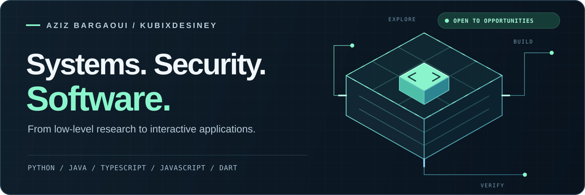

<b>Cloud security &nbsp; / &nbsp; Systems engineering &nbsp; / &nbsp; Software development</b> Aziz Bargaoui · Tunisia · Building security measurement tools and connected applications.

&nbsp;
&nbsp;

<h2 align="center">Languages I build with</h2>

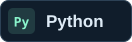
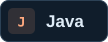
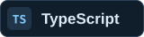
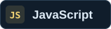

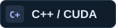
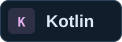

<h2 align="center">Selected builds</h2>

<table>
<tr><td width="50%" align="center" valign="top"> <a href="https://github.com/KubixDesiney/chainbreak"><b>Explore code ↗</b></a> &nbsp;·&nbsp; <a href="https://github.com/KubixDesiney/chainbreak/blob/main/docs/research/results-v0.1.md">AWS measurements</a></td><td width="50%" align="center" valign="top"> <a href="https://github.com/KubixDesiney/gpu-seal"><b>Explore code ↗</b></a> &nbsp;·&nbsp; <a href="https://github.com/KubixDesiney/gpu-seal/blob/main/release-evidence-v0.1.0-alpha.2.txt">Release evidence</a></td></tr>
<tr><td width="50%" align="center" valign="top"> <a href="https://github.com/KubixDesiney/Alert_Sys_App"><b>Explore code ↗</b></a> &nbsp;·&nbsp; <a href="https://github.com/KubixDesiney/Alert_Sys_App/blob/main/lib/services/forecast/gradient_boost.dart">Dart ML implementation</a></td><td width="50%" align="center" valign="top"> <a href="https://github.com/KubixDesiney/aiops"><b>Explore code ↗</b></a> &nbsp;·&nbsp; <a href="https://github.com/KubixDesiney/aiops">Private repository</a></td></tr>
</table>

<h2 align="center">Stack in practice</h2>

<table>
<tr><th width="33%" align="center">Cloud &amp; infrastructure</th><th width="33%" align="center">Applications</th><th width="33%" align="center">Data &amp; integration</th></tr>
<tr><td align="center" valign="top"> 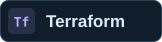  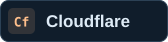 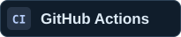 IAM / STS · Infrastructure as code · CI</td><td align="center" valign="top"> 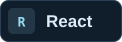 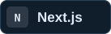 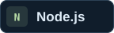  Mobile · Web · APIs · Event-driven systems</td><td align="center" valign="top"> 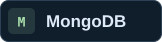 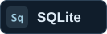 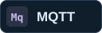 REST · WebSockets · OPC-UA Modbus · Siemens S7</td></tr>
</table>

<h2 align="center">Engineering you can inspect</h2>

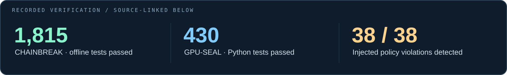 
Recorded project results · <a href="https://github.com/KubixDesiney/chainbreak/blob/main/PROJECT_STATUS.md">CHAINBREAK source</a> · <a href="https://github.com/KubixDesiney/gpu-seal/blob/main/release-evidence-v0.1.0-alpha.2.txt">GPU-SEAL source</a>

<b>Behind the visuals — skills mapped to source code</b>

| Focus | Evidence |
| :--- | :--- |
| **Cloud authorization** | [Python AWS adapter](https://github.com/KubixDesiney/chainbreak/blob/main/src/chainbreak/providers/aws/adapter.py) · [Terraform resources](https://github.com/KubixDesiney/chainbreak/blob/main/infra/terraform/modules/resources/main.tf) |
| **GPU systems &amp; evidence integrity** | [Native C++ / CUDA probes](https://github.com/KubixDesiney/gpu-seal/blob/main/native/gpu_seal_native.cu) · [Ed25519 signing](https://github.com/KubixDesiney/gpu-seal/blob/main/probe/gpu_seal/evidence/signing.py) |
| **TypeScript &amp; web interfaces** | [React / Next.js dashboard](https://github.com/KubixDesiney/gpu-seal/blob/main/dashboard/app/dashboard.tsx) |
| **Connected applications** | [Dart retry queue](https://github.com/KubixDesiney/Alert_Sys_App/blob/main/lib/services/worker_trigger_queue.dart) · [JavaScript escalation worker](https://github.com/KubixDesiney/Alert_Sys_App/blob/main/worker/escalation.js) · [OPC-UA gateway](https://github.com/KubixDesiney/Alert_Sys_App/blob/main/gateway/src/sources/opcua.mjs) |
| **Native Android &amp; machine learning** | [Kotlin voice capture](https://github.com/KubixDesiney/Alert_Sys_App/blob/main/android/app/src/main/kotlin/com/example/alertsysapp/VoiceLockRecorderActivity.kt) · [Pure-Dart gradient boosting](https://github.com/KubixDesiney/Alert_Sys_App/blob/main/lib/services/forecast/gradient_boost.dart) |
| **Java &amp; persistence** | [Team lifecycle](https://github.com/KubixDesiney/Custom_UHC/blob/main/src/teams/UHCTeamManager.java) · [Asynchronous MySQL synchronization](https://github.com/KubixDesiney/Custom_UHC/blob/main/src/Sync/UHCStatusSQLSync.java) |
| **Backend foundations** | [Federee prototype](https://github.com/KubixDesiney/Federee-BackEnd): Node.js / Express, MongoDB, JWT role checks, Socket.IO |

 

 <a href="mailto:contact@kubixdesiney.com"><b>contact@kubixdesiney.com</b></a>

